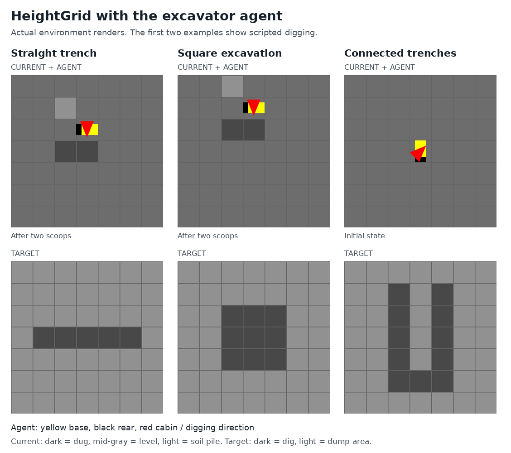
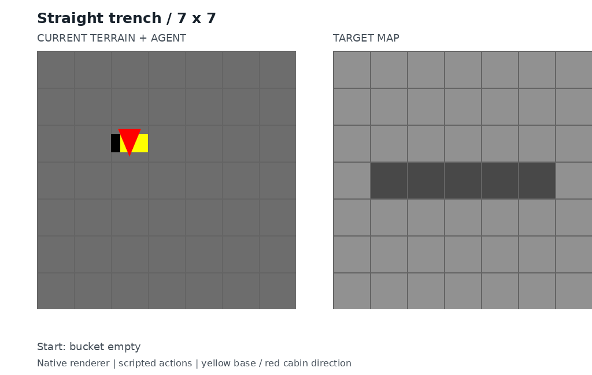

# Heightgrid

Grid environment used to create planners for digging projects.

## Environment preview

The excavator agent has a yellow base, a black rear, and a red triangle showing
the cabin and digging direction. The current terrain is shown above each target
map. Dark cells in the target mark excavation areas; light cells allow dumping.

## Digging example

The animation shows scripted actions: digging, rotating the cabin, dumping soil,
and moving to the next cell. It is not a trained-policy rollout. The current
terrain and agent are on the left; the target map is on the right.

